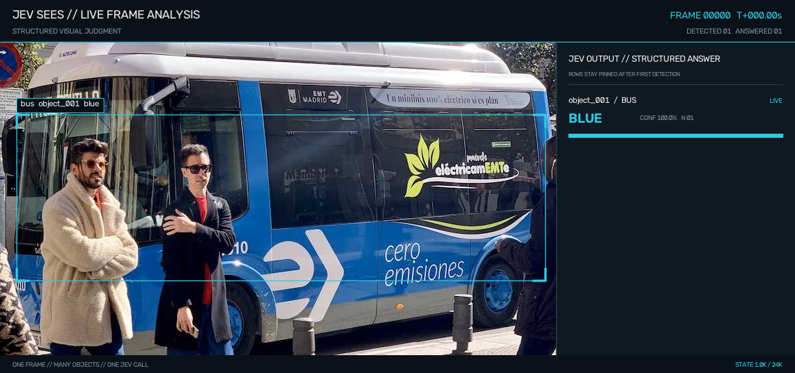
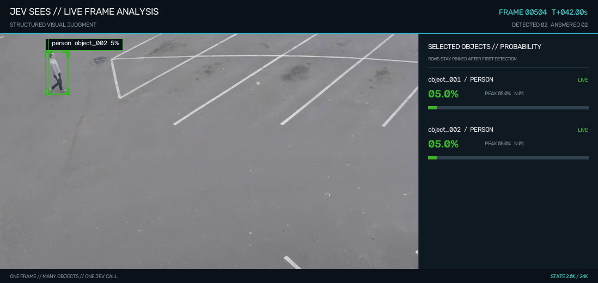
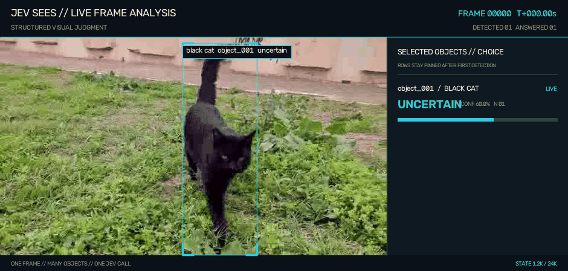

**English** | [中文](README.zh.md)

# JEV Sees

### We gave JEV vision.

**JEV is fast, structured, and built to make decisions.**

[JEV](https://typesafe.ai/blog/introducing-system-one-models-and-jev) is the first **System One Model** from [TypeSafe AI](https://typesafe.ai/), built for fast, structured decisions inside software. JEV Sees is an independent open-source project built on JEV and `typesafe-sdk`; it is not an official TypeSafe AI vision product.

JEV Sees works with images, video, and RGB-D cameras. It finds the objects in view, keeps their IDs consistent across video frames, and asks JEV your question about each relevant object.

<table>
  <tr>
    <th width="33%">Image · bus color</th>
    <th width="33%">Video · pedestrian risk</th>
    <th width="33%">Video · animal motion</th>
  </tr>
  <tr>
    <td></td>
    <td></td>
    <td></td>
  </tr>
  <tr>
    <td><strong>Question:</strong> What color is the bus?<br><strong>Answer:</strong> blue</td>
    <td><strong>Question:</strong> Is this pedestrian currently involved in a car accident?<br><strong>Answer:</strong> one probability per pedestrian</td>
    <td><strong>Question:</strong> What is this animal's current motion state?<br><strong>Answer:</strong> walking</td>
  </tr>
</table>

---

## Quick start

### 1. Install

```bash
git clone https://github.com/CharlesFeng0314/JEV_sees.git
cd JEV_sees
python -m pip install -e .
```

JEV Sees requires Python 3.10+. The first vision run downloads the default Florence-2 and CLIP weights if they are not already available locally.

### 2. Add your JEV API key

Create a key at [console.typesafe.ai/keys](https://console.typesafe.ai/keys).

macOS / Linux:

```bash
export TYPESAFE_API_KEY="your-key"
```

PowerShell:

```powershell
$env:TYPESAFE_API_KEY = "your-key"
```

### 3. Ask your first visual question

This is a complete program, not a wrapper around one of the repository examples:

```python
from jev_sees import Sees

result = Sees().for_each("bus").choice(
    "assets/bus.jpg",
    "What color is this bus?",
    choices=["yellow", "red", "white", "blue", "black", "uncertain"],
    save="bus_answer.png",
)

for row in result.rows:
    print(row["object_id"], row["choice"], row["confidence"])
```

Typical output:

```text
object_001 blue 1.0
```

The saved image includes the detected bus, its stable object ID, and JEV's answer.

---

## Included examples

All three examples use the same flow: media + a question + an explicit answer type. Each script calls JEV and prints structured output in the terminal.

### Bus color

- **Input:** [`assets/bus.jpg`](assets/bus.jpg)
- **Question:** “What color is the bus?”
- **Answer type:** `Choice` from colors supplied by the application

```bash
python examples/bus_color.py
```

```text
object_id   label  choice  confidence
object_001  bus    blue    1.00
```

Source: [`examples/bus_color.py`](examples/bus_color.py)

### Pedestrian accident probability

- **Input:** the 42–50 second segment of [`assets/traffic.mp4`](assets/traffic.mp4)
- **Question:** “Is this object currently involved in a car accident?”
- **Answer type:** probability for every pedestrian in each sampled frame

```bash
python examples/traffic_relations.py
```

```text
frame_index  video_time_s  object_id   label   scope_probability  probability
504          42.00         object_001  person  0.88               0.04
510          42.50         object_001  person  0.92               0.04
```

This asks about what is happening in the current frame; it is not a future-accident forecast. Source: [`examples/traffic_relations.py`](examples/traffic_relations.py). Video attribution: [`assets/CREDITS.md`](assets/CREDITS.md).

### Animal motion

- **Input:** [`assets/black_cat_walking.mp4`](assets/black_cat_walking.mp4)
- **Question:** “What is this animal's current motion state?”
- **Answer type:** `Choice` from `stationary`, `walking`, `running`, and `uncertain`

```bash
python examples/animal_motion.py
```

```text
frame_index  video_time_s  object_id   label      choice    confidence
0            0.00          object_001  black cat  uncertain 0.60
120          5.00          object_001  black cat  walking   0.23
```

Source: [`examples/animal_motion.py`](examples/animal_motion.py)

---

## Choose the answer you need

JEV Sees does not guess the answer format from the wording of a question. Your code chooses it explicitly:

- `probability(...)` returns an independent value from 0 to 1 for every selected object. It uses JEV's official `Noul` question type.
- `choice(...)` selects from options supplied by your application and returns the selected option, confidence, and probability distribution.
- `score(...)` evaluates every selected object against a rubric supplied by your application.

```python
from jev_sees import Sees

sees = Sees()

risk = sees.for_each("pedestrian").probability(
    "assets/traffic.mp4",
    "Is this pedestrian currently involved in a car accident?",
    start=504,
    end=600,
)

motion = sees.for_each("animal").choice(
    "assets/black_cat_walking.mp4",
    "What is this animal's current motion state?",
    choices=["stationary", "walking", "running", "uncertain"],
)

occlusion = sees.for_each("package").score(
    "warehouse.jpg",
    "How obstructed is this package?",
    rubric=["0: clear", "1: partly obstructed", "2: heavily obstructed"],
)
```

Call `Sees().probability(...)`, `.choice(...)`, or `.score(...)` without `for_each(...)` to ask about every detected object. `Choice`, `Noul`, `Score`, and `TypeSafeClient` are also re-exported for applications that want to construct official JEV questions directly.

---

## Inputs and results

### Images

Pass an image path, a PIL image, or an RGB NumPy array. Each result row identifies the object that was judged.

### Video

Object IDs remain stable across consecutive sampled frames, so answers can be graphed, thresholded, or used to trigger an action. By default, JEV Sees samples roughly twice per second. Use `every=1` for every frame or `every=N` for every Nth frame.

### RGB-D cameras

RGB-D is supported for live camera loops through `observe(rgb, depth, intrinsics=...)`. When camera intrinsics are available, objects can include metric 3D positions and distances. The same objects can then be passed to JEV with `ask(...)`.

### Program and file output

- `result.answers`: JEV answers keyed by object ID
- `result.rows`: one summary row per object
- `result.frames`: answers grouped by sampled video frame
- `save="output.gif"`: annotated image, GIF, or video with live answers
- `json="output.json"` and `excel="output.xlsx"`: structured exports

Every selected object in one sampled frame is included in the same JEV request.

---

## Models and local vision

Image and video perception run locally. The default detector/captioner is `microsoft/Florence-2-base-ft`; select another compatible checkpoint with:

```python
Sees(florence_model="microsoft/Florence-2-large-ft")
```

If `JEV_SEES_ROBO_ROOT` points to a project containing `weights/clip/ViT-B-32.pt`, JEV Sees uses that local CLIP weight. Otherwise it downloads the weight on first use. Model weights are not committed to this repository.

---

## Development

Run the test suite with:

```bash
python -m unittest discover -s tests -v
```

If `import jev_sees` fails after installation, make sure `python -m pip install -e .` and your program use the same Python interpreter.

JEV Sees began as the visual layer of [JEV Control Your Roboarm](https://github.com/CharlesFeng0314/JEV_control_your_roboarm) and is now a standalone project for images, video, cameras, and robotics.

The project is currently **v0.1.0** and experimental. The public API, perception stack, and examples may continue to change.

## License

MIT
